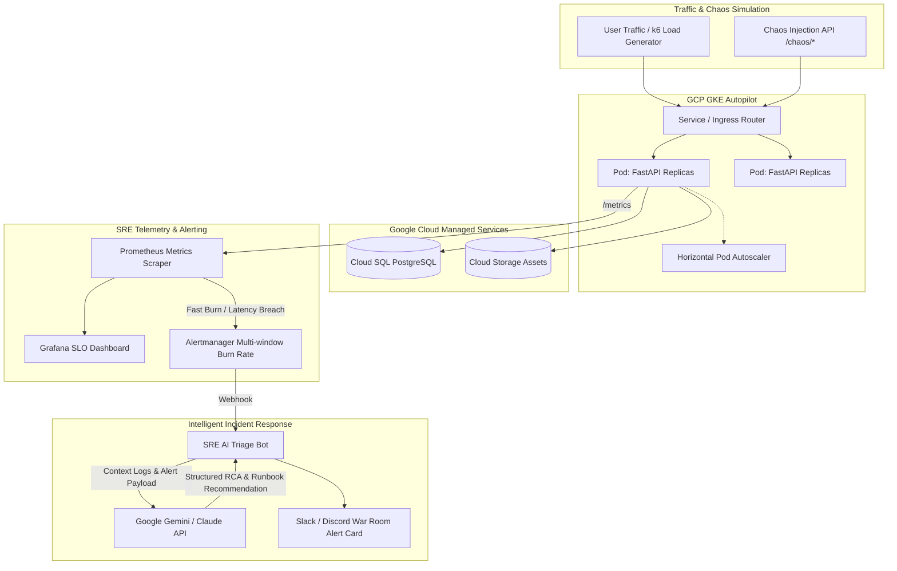

# Production SRE & Observability Lab on Google Cloud (GCP)

[](https://github.com/davimartins/sre-gcp-lab/actions)
[](https://www.terraform.io/)
[](https://cloud.google.com/kubernetes-engine)
[](https://prometheus.io/)
[](https://grafana.com/)
[](https://fastapi.tiangolo.com/)
[](LICENSE)

> **End-to-End Site Reliability Engineering (SRE) implementation** demonstrating production-grade reliability practices: Infrastructure as Code (Terraform), SLO/Error Budget multi-window alerting, automated chaos engineering injection, and an **AI Incident Triage Bot (Gemini / Claude)** for rapid Root Cause Analysis (RCA).

---

## Architecture Overview



---

## Core SRE Principles Implemented

### 1. Service Level Objectives (SLOs) & Error Budgets
Based on the **Google SRE Workbook (Chapter 5: Alerting on SLOs)**, standard threshold alerting (like arbitrary CPU spikes) leads to alert fatigue. This lab implements **Multi-Window Multi-Burn-Rate Alerts**:

| Metric | Target | Monthly Budget | Fast Burn (Page - 14.4x) | Medium Burn (Ticket - 6x) |
| :--- | :--- | :--- | :--- | :--- |
| **Availability SLI** | 99.5% | 0.5% (0.005) | Consumes 2% in 1 hour (1h + 5m window) | Consumes 5% in 6 hours (6h + 30m window) |
| **Latency SLI** | 95% < 300 ms | 5.0% | P95 latency > 300ms for > 3 minutes | Continuous degradation tracker |

### 2. Built-in Chaos Engineering & Fault Injection
The FastAPI application features live chaos endpoints to simulate real outages without altering application code:
- `POST /chaos/inject-latency?delay_seconds=1.5` — Injects artificial latency to trigger `HighP95Latency`.
- `POST /chaos/inject-error?rate=0.25` — Returns HTTP 500 on 25% of requests to burn the Error Budget and trip `FastErrorBudgetBurn`.
- `POST /chaos/reset` — Instantly restores healthy baseline behavior.

### 3. AI Incident Triage Bot (AIOps)
When Alertmanager fires, it dispatches an asynchronous webhook to the Python triage bot (`triage-bot/`):
1. Ingests Alertmanager JSON payload and container log traces.
2. Prompts Gemini 1.5 Flash / Claude to synthesize:
   - **Root Cause Hypothesis**
   - **Blast Radius & SLO Impact**
   - **Recommended Mitigation Steps** (with precise `kubectl` / rollback commands)
   - Links the designated **Runbook URL**.
3. Posts an actionable triage card into the War Room (Slack/Discord) and logs the event to disk for post-mortem auditing.

---

## Repository Structure

```
sre-gcp-lab/
├── app/                      # Production FastAPI backend with Prometheus instrumentation & chaos APIs
│   ├── Dockerfile            # Multi-stage secure Docker build (non-root user)
│   ├── requirements.txt      # Python dependencies
│   └── main.py               # Application logic, health checks & telemetry
├── infra/terraform/          # Reusable Terraform IaC for Google Cloud
│   ├── main.tf               # VPC, GKE Autopilot, Cloud SQL (db-f1-micro), GCS, Artifact Registry
│   ├── variables.tf          # Parameterized inputs (region, project_id, environment)
│   └── outputs.tf            # Cluster endpoints, bucket URLs, connection strings
├── k8s/                      # Kubernetes production manifests
│   ├── deployment.yaml       # RollingUpdate, resource requests/limits, probes, scrape annotations
│   ├── service.yaml          # ClusterIP service
│   └── hpa.yaml              # Horizontal Pod Autoscaler targeting 75% CPU
├── observability/            # Monitoring & Alerting configuration
│   ├── prometheus/           # Prometheus scraping & Multi-window SLO burn rate alert rules
│   ├── alertmanager/         # Alert routing to AI Triage Bot
│   └── grafana/              # Pre-provisioned SLO and Golden Signals dashboard
├── triage-bot/               # AI-powered alert triage microservice (FastAPI + LLMs)
├── runbooks/                 # Standard Operating Procedures (SOPs) for on-call responders
│   ├── high-error-rate.md
│   ├── high-latency.md
│   └── api-down.md
├── postmortems/              # Real blameless incident reports (Bilingual: English & Portuguese)
│   └── INC-2026-11-04-database-timeout.md
├── .github/workflows/        # GitHub Actions CI/CD (lint, terraform validation, Trivy vulnerability scan)
├── docker-compose.yml        # 1-Click local reproduction stack
└── Makefile                  # Operational command automation
```

---

## 1-Minute Quickstart (Run Entire Stack Locally)

You can spin up the full production observability environment locally using Docker Compose without needing active GCP credentials:

```bash
# Clone the repository
git clone https://github.com/davimartins/sre-gcp-lab.git
cd sre-gcp-lab

# Start FastAPI, Prometheus, Alertmanager, Grafana, and AI Triage Bot
make up
```

### Access Services:
- **FastAPI API & Docs:** `http://localhost:8000/docs`
- **Prometheus UI:** `http://localhost:9090`
- **Alertmanager:** `http://localhost:9093`
- **Grafana Dashboard:** `http://localhost:3000` (User: `admin` | Password: `admin`)
- **AI Triage Bot:** `http://localhost:5001/healthz`

---

## Live Incident Simulation & Verification

Follow this script to verify the end-to-end incident lifecycle:

```bash
# 1. Start continuous background traffic
make load &

# 2. Inject Chaos: trip 25% HTTP 500 error rate
make chaos-error

# 3. Watch Grafana:
# - Error rate spikes to 25%
# - Availability drops below 99.5%
# - Burn Rate exceeds 14.4x

# 4. Check Alertmanager (http://localhost:9093):
# - Alert 'FastErrorBudgetBurn' transitions from PENDING to FIRING

# 5. Check AI Triage Bot output:
docker compose logs -f triage-bot
# Notice the automated RCA diagnostic card and remediation actions generated

# 6. Resolve Incident:
make chaos-reset

# 7. Observe metrics return to normal in Grafana and alert marks RESOLVED
```

---

## Cloud Deployment (Google Cloud Platform)

### Prerequisites
- Google Cloud SDK (`gcloud` CLI) installed and authenticated
- Terraform `>= 1.6.0`

### Provisioning Infrastructure
```bash
cd infra/terraform
terraform init
terraform plan -var="project_id=YOUR_GCP_PROJECT_ID"
terraform apply -var="project_id=YOUR_GCP_PROJECT_ID" -auto-approve
```

---

## Incident Management & Post-Mortems
- Check our [Bilingual Post-Mortem INC-2026-11-04](postmortems/INC-2026-11-04-database-timeout.md) for a real example of root-cause analysis, 5-Whys methodology, and preventative action tracking.
- Follow operational SOPs in [`runbooks/`](runbooks/).

---

## Author

**Davi Goulart Martins**  
*Site Reliability Engineer (SRE) | Cloud & Incident Management*  
- **LinkedIn:** [linkedin.com/in/davi-martins-sre](https://linkedin.com)  
- **Email:** davi.martinsgoulart@gmail.com  
- **Location:** Jundiaí / Barueri - SP, Brazil
