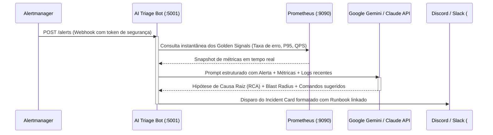

# Case Study: Sustentação de Ambientes Críticos & SRE no Google Cloud
> **Alinhamento Técnico & Operacional para o perfil de SRE na Proative Technology**  
> Autor: **Davi Goulart Martins** | Repositório: [`sre-gcp-lab`](https://github.com/davibournegoulart-wq/sre-gcp-lab)

---

## 1. Visão Executiva & Contexto de Negócio

A **Proative Technology** é reconhecida por entregar excelência em **Serviços Gerenciados de TI (MSP)** para operações críticas de alta disponibilidade. Em um ambiente gerenciado, o cliente final não avalia apenas se a aplicação está online; ele avalia:
1. **Previsibilidade:** Capacidade de antecipar degradações antes que o usuário final seja impactado.
2. **Tempo de Resposta (MTTR):** Rapidez e disciplina operacional para conter incidentes (P1 a P4).
3. **Melhoria Contínua:** Análise profunda de causa raiz (RCA) para garantir que uma falha jamais se repita.
4. **Eficiência de Custos (FinOps):** Dimensionamento adequado de capacidade sem desperdício de nuvem.

Este projeto foi construído do zero para simular e operar uma **aplicação corporativa em produção real no Google Cloud Platform (GCP)**, cobrindo todos os requisitos de sustentação, automação, observabilidade e governança exigidos na operação da Proative.

---

## 2. Arquitetura da Solução no Google Cloud (GCP)

A infraestrutura foi desenhada seguindo os pilares de **segurança em camadas, alta disponibilidade e menor privilégio (Zero Trust)**, provisionada 100% como código via **Terraform**:

```
                       [ Tráfego Externo / Usuários / k6 ]
                                      │
                                      ▼
                        [ Cloud Load Balancer (VIP:80) ]
                                      │
             ┌────────────────────────┴────────────────────────┐
             ▼                                                 ▼
   [ GKE Autopilot Subnet ]                         [ Cloud NAT & Router ]
   • Pods FastAPI (250m / 512Mi)                    • Egress seguro para nós privados
   • HPA (Autoscaling 2 a 8 réplicas)               • Chamadas externas sem expor IPs públicos
   • Probes: /healthz, /ready, /metrics
             │
             ├─────────────────────────────────────────────────┐
             ▼ (VPC Peering Privado)                           ▼
   [ Cloud SQL (PostgreSQL 15) ]                    [ Google Cloud Operations ]
   • IP 100% interno (Zero IP público)              • Cloud Logging (JSON estruturado)
   • db-f1-micro / db-custom                        • Cloud Monitoring (Métricas)
   • Conexões autenticadas                          • Cloud Billing Budget Alerts ($25)
```

### Competências GCP Demonstradas:
- **GKE (Google Kubernetes Engine) Autopilot:** Gerenciamento serverless do plano de controle e nós, eliminando custo de nós ociosos e focando em SLAs de contêineres.
- **Compute Engine & Redes:** VPC customizada (`10.10.0.0/20`), subnets dedicadas com intervalos secundários para Pods (`10.48.0.0/14`) e Services (`10.52.0.0/20`), Cloud Router e Cloud NAT para saída de internet segura.
- **Cloud SQL:** Banco relacional PostgreSQL isolado com **VPC Peering**, eliminando qualquer exposição a ataques pela internet pública.
- **Cloud Storage (GCS):** Armazenamento de assets e versionamento do estado remoto (`tfstate`) do Terraform com criptografia nativa.
- **Segurança & IAM (Zero Keys):** Deploy via GitHub Actions utilizando **Workload Identity Federation (WIF)** via tokens OIDC temporários, banindo chaves de serviço em arquivo JSON no repositório.

---

## 3. Matriz de Confiabilidade: SLIs, SLOs & Error Budgets

Seguindo a disciplina do Google SRE Handbook, a sustentação do serviço abandona métricas estáticas (ex: "CPU em 80%") e adota indicadores centrados na **experiência do usuário**:

| Métrica | Indicador de Nível de Serviço (SLI) | Objetivo (SLO) | Janela | Orçamento de Erro (Error Budget) |
|---|---|---|---|---|
| **Disponibilidade** | $\frac{\text{Requisições com Status } < 500}{\text{Total de Requisições}}$ | **99.5%** | 30 dias | 0.5% de falhas permitidas (~3.6 horas/mês) |
| **Latência** | Tempo de resposta medido no percentil p95 | **p95 < 300 ms** | 30 dias | 5% das requisições podem oscilar acima de 300ms |
| **Integridade (Liveness)** | Resposta HTTP 200 no probe `/healthz` | **99.9%** | 7 dias | 3 falhas consecutivas disparam reinício automático do pod |

---

## 4. Gestão de Incidentes ITIL & Matriz de Severidade (P1 a P4)

A Proative exige gestão estruturada de incidentes em ambientes produtivos. Os alertas do Prometheus e Alertmanager foram configurados com base na **velocidade de consumo do Error Budget (Multi-Window Multi-Burn-Rate)**:

```
                            [ Incidente Detectado ]
                                      │
         ┌────────────────────────────┼────────────────────────────┐
         ▼                            ▼                            ▼
   [ SEVERIDADE P1 ]            [ SEVERIDADE P2 ]            [ SEVERIDADE P3 / P4 ]
   • Fast Burn Rate (14.4x)     • Slow Burn Rate (6x)        • Flapping de Pods
   • API Totalmente Down        • Latência P95 > 300ms       • Alertas de Capacidade
   • MTTA: < 5 min              • MTTA: < 15 min             • MTTA: < 1 hora
   • MTTR Alvo: < 30 min        • MTTR Alvo: < 2 horas       • MTTR Alvo: < 8 horas
         │                            │                            │
         ▼                            ▼                            ▼
   [ Pager / War Room ]         [ Ticket Prioritário ]       [ Fila de Sustentação ]
   + Acionamento Imediato       + Investigação em horário    + Análise preventiva
```

### Definição dos Níveis de Severidade:
1. **P1 (Crítico / Impacto Total):**
   - *Gatilho:* `FastErrorBudgetBurn` (queima de >2% do orçamento de erro em 1 hora, taxa de erro >7.2%) ou `APIDown`.
   - *Ação:* Abertura imediata de War Room, acionamento do Incident Commander e execução do runbook de contenção rápida.
2. **P2 (Alto / Degradação Severa):**
   - *Gatilho:* `MediumErrorBudgetBurn` (queima de 5% em 6 horas) ou `HighP95Latency` persistente por mais de 3 minutos.
   - *Ação:* Investigação de gargalos de banco ou dependências externas via logs agregados.
3. **P3 (Médio / Degradação Parcial):**
   - *Gatilho:* `PodRestartFlapping` (mais de 2 reinícios em 15 minutos).
   - *Ação:* Verificação de limites de memória (OOMKilled) e ajuste de limites do deployment.
4. **P4 (Baixo / Informativo):**
   - *Gatilho:* Alertas de tendências de tráfego ou aviso de expiração de certificados.

---

## 5. Diferencial Competitivo: Triagem AIOps com LLM (Gemini / Claude)

Em operações tradicionais de sustentação, o tempo entre o alarme tocar e o operador entender o que aconteceu (MTTI - *Mean Time to Identify*) varia de 10 a 25 minutos. 

Neste lab, foi desenvolvido um **Agente de Triagem com Inteligência Artificial** (`triage-bot`):



### Resultado Prático:
- **Redução de MTTR:** O operador recebe no Slack/Discord a causa mais provável e os comandos exatos de rollback/mitigação **em menos de 3 segundos**.
- **Segurança de Execução:** Proteção por token secreto (`ALERT_WEBHOOK_TOKEN`) e limites diários de requisição (*rate limiting*) para prevenir abuso ou consumo excessivo de cota da API.

---

## 6. Procedimentos Operacionais (Runbooks) & Análise de Causa Raiz (RCA)

Nenhum alerta entra em produção sem um procedimento documentado:
- [`runbooks/api-down.md`](file:///Users/rollframe/.gemini/antigravity/scratch/sre-gcp-lab/runbooks/api-down.md): Procedimentos para pods em CrashLoopBackOff, verificação de probes e reinício emergencial.
- [`runbooks/high-error-rate.md`](file:///Users/rollframe/.gemini/antigravity/scratch/sre-gcp-lab/runbooks/high-error-rate.md): Isolamento de falhas 5xx, rollback imediato com `kubectl rollout undo` e verificação de conexões com o Cloud SQL.
- [`runbooks/high-latency.md`](file:///Users/rollframe/.gemini/antigravity/scratch/sre-gcp-lab/runbooks/high-latency.md): Diagnóstico de contenção de CPU/Memory, saturação de pool de conexões e escalonamento manual do HPA.

### Disciplina de Post-Mortem Bilíngue (PT/EN):
O relatório [`postmortems/INC-2026-11-04-database-timeout.md`](file:///Users/rollframe/.gemini/antigravity/scratch/sre-gcp-lab/postmortems/INC-2026-11-04-database-timeout.md) demonstra na prática o método **Blameless Post-Mortem**:
1. **Resumo do Impacto:** Duração total da indisponibilidade, requisições afetadas e percentual de Error Budget consumido.
2. **Linha do Tempo Cirúrgica (Timeline):** Registro minuto a minuto desde a injeção do problema, detecção, mitigação até a normalização.
3. **Análise de Causa Raiz (5 Porquês):** Investigação técnica estruturada sem culpabilização individual.
4. **Plano de Ação Corretiva (Action Items):** Itens com responsáveis e prazos para eliminar a classe de falha definitivamente.

---

## 7. Como Apresentar Este Case para o Gestor da Proative

Durante a entrevista técnica, a narrativa recomendada é:

> *"Como a Proative é especialista em sustentação e ambientes de missão crítica, decidi não fazer um projeto de tutorial básico. Eu montei uma infraestrutura real no GCP que reflete exatamente a rotina de um MSP: provisionamento com Terraform, pods no GKE com segurança não-root, banco isolado com IP privado e monitoramento baseado em SLO e queima de Error Budget. Quando um alerta P1 dispara, meu bot de IA já tria os logs e entrega a causa raiz no chat com o runbook associado, derrubando o MTTR para poucos minutos."*

